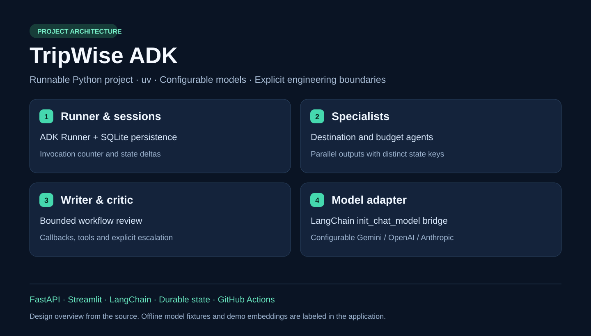

# TripWise ADK

**Google ADK travel workflow with parallel specialists, tools, callbacks, bounded review and durable SQLite sessions.**

[](https://github.com/Swaroopfullstack/tripwise-google-adk/actions/workflows/ci.yml)
[](https://github.com/Swaroopfullstack/tripwise-google-adk/actions/workflows/secrets.yml)

Python · uv · Gemini via LangChain `init_chat_model` · FastAPI · Streamlit · SQLite

## Architecture at a glance



Source-based architecture overview. Follow the [walkthrough](docs/WALKTHROUGH.md) to run the actual workflow.

## What this project demonstrates

Runner → Session state → Parallel specialists → Writer → Bounded review

Explore the [step-by-step demonstration](docs/WALKTHROUGH.md) and the [main implementation](src/portfolio/adk_project.py). This repository contains its own source code, public fixtures, dependency lock, API, dedicated UI, tests and container configuration. Clone this repository by itself to run it.

## Quick start

Use Python 3.11–3.13 and uv. Run from this repository root:

```powershell
git clone https://github.com/Swaroopfullstack/tripwise-google-adk.git
cd tripwise-google-adk
uv sync --frozen --extra adk --extra gradio
Copy-Item .env.example .env
uv run --frozen python demo.py
```

For macOS/Linux, replace `Copy-Item .env.example .env` with `cp .env.example .env`.

The default demo needs no paid API key. Real graphs, persistence, loaders, retrieval, ML and tools execute locally; model routing/writing use labeled deterministic fixtures. Demo embeddings are a lexical hashing baseline. Enable live inference and semantic embeddings explicitly below.

## Open the dedicated application

Terminal 1:

```powershell
uv run uvicorn portfolio.api:app --host 127.0.0.1 --port 8000 --workers 1
```

Terminal 2:

```powershell
uv run streamlit run app.py --server.address 127.0.0.1 --server.port 8501
```

Open http://localhost:8501. This opens **TripWise ADK** directly. Local development identities: `demo-alice-key`, `demo-bob-key`, `demo-reviewer-key`. Public CSV/PDF samples, attribution and hashes are in [assets/public](assets/public). The API contract is at http://localhost:8000/docs. Each checkout uses its own runtime directory. To run several repositories at once, assign distinct API/UI ports and set each UI's `API_BASE_URL` accordingly.

### ADK developer UI and durable CLI

```powershell
uv run --extra adk adk web agents --port 8011
uv run --extra adk portfolio adk --question "Plan three days in Lisbon"
# Copy the returned session ID to continue the same durable CLI session.
uv run --extra adk portfolio adk --session YOUR_SESSION_ID --question "Review the assumptions"
```

## Gemini, providers and retrieval controls

The [Gemini example](.env.gemini.example) and [setup guide](docs/ENV_SETUP.md) explain private configuration. Install semantic embedding support with `uv sync --frozen --extra embeddings --extra adk --extra gradio`, then edit your private `.env`:

```dotenv
RUN_MODE=live
LLM_PROVIDER=google_genai
LLM_MODEL=gemini-3.8-flash
GOOGLE_API_KEY=REPLACE_WITH_YOUR_PRIVATE_KEY
LLM_TEMPERATURE=
LLM_TOP_P=
LLM_TOP_K=
LLM_MAX_TOKENS=1600
EMBEDDING_BACKEND=huggingface
EMBEDDING_MODEL=sentence-transformers/all-MiniLM-L6-v2
RETRIEVAL_K=4
RETRIEVAL_FETCH_K=16
```

Use a model ID available to your account. Switch both provider and model for OpenAI or Anthropic, and provide that provider's private key. Supported sampling controls vary by provider; OpenAI top-k is rejected explicitly. Generation top-k and retrieval k control different operations. Restart after changing configuration and re-index documents after changing embeddings. [Configuration details](docs/CONFIGURATION.md).

## Test and deploy

```powershell
uv run ruff check src tests app.py demo.py
uv run pytest -q
docker compose up --build
```

CI runs the runtime regression suite plus a dedicated real-HTTP Streamlit check for this project. The deployment contract is **one API instance, one worker, durable local storage**. Authentication, tenant ownership, request limits, bounded workers and provider budgets are implemented. Live-provider evaluation, Docker execution, cloud deployment, load tests and restore drills require verification in your deployment environment. [Deployment guide](docs/DEPLOYMENT.md).

## Code map

| Path | Purpose |
|---|---|
| [app.py](app.py) | Dedicated TripWise ADK Streamlit entry point |
| [demo.py](demo.py) | Focused workflow demonstration |
| [src/portfolio/adk_project.py](src/portfolio/adk_project.py) | Main project implementation |
| [src/portfolio/models.py](src/portfolio/models.py) | Provider-neutral model factory and budgets |
| [src/portfolio/config.py](src/portfolio/config.py) | Typed configuration and trusted identity |
| [tests](tests) | Workflow and shared-runtime regression checks |
| [docs/WALKTHROUGH.md](docs/WALKTHROUGH.md) | Demo script, concepts and tradeoffs |

## Source and portfolio

Extracted from [AI Engineering Portfolio](https://github.com/Swaroopfullstack/agentic-ai-portfolio) at `d4880b602e47`. The common `portfolio` runtime is intentionally vendored in full to preserve tested authorization, storage, model and protocol behavior. Only this project's launchers are included; there is no dependency on another checkout. Shared runtime tests may exercise supporting capabilities used by other projects. This is a standalone showcase application, not a claim that seven unrelated codebases were built independently.

Public datasets/PDFs retain their [provenance](assets/public/PROVENANCE.json). See the [portfolio directory](https://github.com/Swaroopfullstack/agentic-ai-portfolio#standalone-project-repositories) for the other projects.

## Open source license

Original application code is available under the [MIT license](LICENSE). See [contributing](CONTRIBUTING.md) to run checks and submit improvements. Public data, dependencies and model weights retain their respective licenses and attribution.
